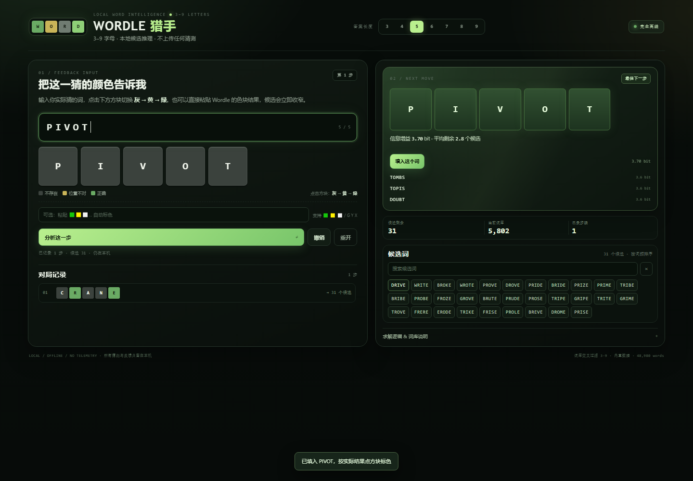

# Wordle 猎手 · 3–9 字母本地辅助器

一个完全离线的 Wordle 辅助器：输入你在真实游戏里的猜测和 Wordle 反馈，实时筛选候选，并给出下一步推荐。不是可玩的猜词游戏。



## 功能

- **3–9 字母**：顶部可切换答案长度，词库和推荐会同步切换。
- **反馈录入**：输入实际猜测后，点击字母方块切换「灰 → 黄 → 绿」；也可以粘贴 Wordle 的 `🟩🟨⬜` 色块结果自动标色。
- **严格候选过滤**：复刻 Wordle 重复字母规则——绿色固定位置，黄色字母存在但排除该位置，灰色字母在该位置排除且数量受已确认次数限制。
- **下一步推荐**：在候选集上评估猜测的反馈分布熵，优先展示信息增益更高、平均剩余候选更少的词；候选只剩一个时直接锁定答案。
- **完全离线**：HTML、CSS、JS 和词库全部内联在一个文件中，不发起任何网络请求，不上传猜测或反馈。
- **本地词库**：内置 48,980 个 3–9 字母英文词（3 字母 1,046 个，9 字母 9,192 个），按词频排序。

## 使用

1. 下载或克隆本仓库，双击 `index.html`。
2. 在顶部选择答案长度（3–9）。
3. 输入你在真实游戏中猜过的词，按实际结果点击方块标色；也可以粘贴色块。
4. 点击「分析这一步」，左侧记录对局，右侧显示最佳下一步和候选列表。

推荐词只是辅助，不保证是官方答案表里的词。

## 词库与限制

词库由 [word-list](https://github.com/sindresorhus/word-list)（MIT）与 [subtlex-word-frequencies](https://github.com/zeke/subtlex-word-frequencies)（ISC）的 SUBTLEXus 词频数据交叉过滤得到，仅保留全小写、长度为 3–9、在 word-list 中存在且词频为正的词，并按词频降序排列。

因此它**不是 NYT 官方 Wordle 答案表**：冷门答案可能不在词库中，词库中也可能包含不适合作为答案的常见词。遇到不在词库中的答案时，仍可正常完成游戏，只是辅助器无法再给出该答案的候选。

候选超过 1,600 个时，推荐部分会用等距抽样估算信息增益；候选筛选始终是精确的。九字母首猜全灰这类大候选场景，推荐结果会标注「抽样估算」。

Wordle 是他人商标，本项目为非官方离线辅助器。

## 目录

```text
index.html                    # 完整工具（自包含，可直接打开）
README.md
docs/screenshot.png           # 界面截图
LICENSE                       # 代码许可证（MIT）
THIRD_PARTY_LICENSES.md       # 词库许可证全文
```

## 开发

`index.html` 即完整源码：样式、脚本和词库都内联在文件中。修改后直接在浏览器打开即可，无需构建步骤。

## 许可证

代码采用 MIT License，见 [LICENSE](LICENSE)。词库数据遵循各自的 MIT / ISC 许可证，全文见 [THIRD_PARTY_LICENSES.md](THIRD_PARTY_LICENSES.md)。
